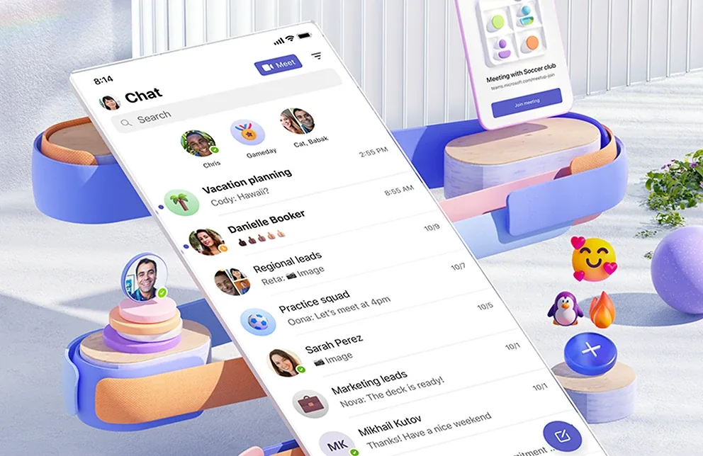

# fluent2-avalonia

Based on Microsoft's **[Fluent 2 design system](https://fluent2.microsoft.design/)**, the design language behind Windows, Microsoft 365 and Teams.



*Fluent 2 in practice: layered surfaces, rounded shapes, expressive color and clear hierarchy, here in Microsoft Teams. Image © Microsoft, from fluent2.microsoft.design.*


*The Fluent 2 website at [fluent2.microsoft.design](https://fluent2.microsoft.design/): design language, guidelines and components per platform. This skill condenses those pages into rules and checklists for Avalonia. Image © Microsoft.*

The two images above are © Microsoft Corporation and are shown for reference only; they are not covered by this repository's MIT license.

The skill is Markdown only: it runs no code, sends nothing and fetches nothing. See [PRIVACY.md](PRIVACY.md).

A skill for Claude Code and Claude.ai that teaches Claude to build and review Avalonia desktop UIs the way Microsoft's Fluent 2 design system describes them: component behavior, states, keyboard handling, accessibility, content design, motion, and responsible AI patterns, with checklists you can verify and patterns for headless Avalonia tests.

It is aimed at developers who build Avalonia (AXAML) apps with Claude and want consistent, accessible, keyboard-friendly interfaces without re-deriving the rules each time. Typical triggers: "build a time field", "review my TextBox style", "add an AI suggestion panel", "why can't I tab through this form".

Tested in practice across five implementation rounds on an Avalonia 12 desktop app; Avalonia 11 names are listed alongside.

The skill never replaces your own design brief. If a project has a brief or tokens, those values win; Fluent values are the fallback, and deliberate deviations are recorded with a reason.

## Install

**With the `skills` CLI** (works for Claude Code and other agents, same as most public skills):

```bash
npx skills add vompa/fluent2-avalonia-skill --skill fluent2-avalonia
```

Add `-g` to install it for all your projects instead of the current one.

**As a Claude Code plugin** (this repository is also a plugin marketplace):

```bash
claude plugin marketplace add vompa/fluent2-avalonia-skill
claude plugin install fluent2-avalonia@vompa-skills
```

Inside a session, `/plugin marketplace add vompa/fluent2-avalonia-skill` and `/plugin install fluent2-avalonia@vompa-skills` do the same. The skill then runs as `/fluent2-avalonia:fluent2-avalonia` and triggers on its own when a task matches its description.

**By hand:** copy the folder `fluent2-avalonia/` into `.claude/skills/` inside your project (shared with the team through the repository) or into `~/.claude/skills/` (available in all your projects).

```bash
cp -r fluent2-avalonia ~/.claude/skills/
```

**For Claude.ai**, zip the folder as a `.skill` package (the archive root contains the `fluent2-avalonia/` folder) and upload it in the skills settings. Packaging details follow Anthropic's skill documentation.

## Structure

```text
.claude-plugin/
  plugin.json                 Claude Code plugin manifest (points at fluent2-avalonia/)
  marketplace.json            marketplace entry so the repository can be added with one command
fluent2-avalonia/
  SKILL.md                    entry point: when it applies, how to work, rules at a glance
  references/
    foundations.md            layout, type, color, elevation, motion, shape, tokens, deviations
    inputs.md                 field anatomy, states, behavior matrix, parsers for time/date/number/money
    buttons-and-selection.md  buttons, links, checkbox, radio, switch, slider
    navigation.md             tabs, navigation pane, menus, toolbar overflow, tooltips
    dialogs-and-messages.md   dialogs, drawers, message bars, toasts, progress
    data-display.md           lists, tables, cards, avatars, badges, accordions
    content-design.md         UI text, error messages, formats
    accessibility.md          keyboard, focus, F6 regions, screen readers, contrast, motion
    responsible-ai.md         AI disclosure, control, agents, review rubric
    avalonia-mapping.md       Fluent concepts as selectors, resources, behaviors, headless tests
    avalonia-12-notes.md      Avalonia 11 to 12 names, changed behavior, observed pitfalls
  evals/evals.json            three realistic test prompts
scripts/validate.py           structure and link checks for contributors (standard library only)
```

The two reference images shown above live in a `docs` folder and are not part of the skill.

Claude reads `SKILL.md` first and opens a reference file only when the task needs it.

## Check

```bash
python scripts/validate.py
```

The script checks the frontmatter, the `SKILL.md` length, that referenced files exist, that local Markdown links and anchors resolve, and that `evals/evals.json` is well formed. It makes no network requests. The same check runs in GitHub Actions on every push.

## Sources and relationship to Microsoft

The content is an independent, paraphrased summary built from public sources: the [Fluent 2 design system](https://fluent2.microsoft.design), Microsoft Learn documentation for WinUI 3 and Windows design, and the open source [Fluent UI](https://github.com/microsoft/fluentui) repository. Each rule links to its source in the reference file where it appears.

This project is not affiliated with or endorsed by Microsoft. Fluent, Segoe, Windows and WinUI are trademarks of Microsoft Corporation. Microsoft texts are paraphrased, not copied. Values marked "Derived" are recommendations of this skill, not Microsoft rules, and values marked "derived, not verified" were not checked against a running app or a source.

## License

MIT, see [LICENSE](LICENSE).

## Deutsch

Dieser Skill bringt Claude bei, Avalonia-Desktopoberflächen nach dem Designsystem Fluent 2 von Microsoft zu bauen und zu prüfen: Verhalten von Komponenten, Zustände, Tastaturbedienung, Barrierefreiheit, Texte, Bewegung und verantwortungsvolle KI-Muster, jeweils mit prüfbaren Checklisten und Mustern für Headless-Tests.

Installation: `npx skills add vompa/fluent2-avalonia-skill --skill fluent2-avalonia`, oder als Claude-Code-Plugin mit `claude plugin marketplace add vompa/fluent2-avalonia-skill` und `claude plugin install fluent2-avalonia@vompa-skills`, oder den Ordner `fluent2-avalonia/` von Hand nach `.claude/skills/` im Projekt beziehungsweise `~/.claude/skills/` kopieren. Prüfung: `python scripts/validate.py`.

Hat ein Projekt einen eigenen Design-Brief oder eigene Tokens, gelten diese Werte; Fluent ist nur die Rückfallebene, und bewusste Abweichungen werden mit Begründung notiert. Die Inhalte sind sinngemäß zusammengefasst, nicht aus den Microsoft-Texten kopiert; das Projekt ist unabhängig und steht in keiner Verbindung zu Microsoft. Grundlage ist das Designsystem [Fluent 2](https://fluent2.microsoft.design/) von Microsoft; die beiden Bilder oben (Teams-Chat als Beispiel für Fluent 2 in der Praxis, Ansicht der Fluent-2-Website) stammen von dort und sind © Microsoft, nicht Teil der MIT-Lizenz. Sprache der Skill-Dateien: Englisch. Lizenz: MIT.
